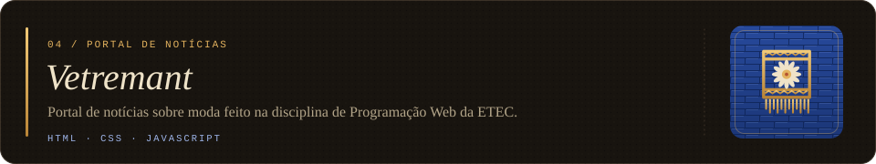
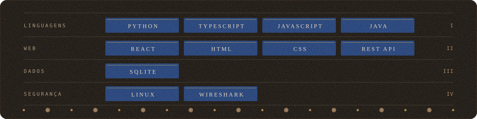

  <picture>
    <source media="(prefers-reduced-motion: reduce)" srcset="assets/hero-static.svg">
    
  </picture>

### oi, eu sou o Ryan

Estudo Desenvolvimento de Sistemas na ETEC e faço estágio em cibersegurança. Gosto de construir sistemas que resolvem problemas reais, principalmente com Java e Spring, e ando cada vez mais curioso sobre IA e agentes.

O visual daqui vem do mundo antigo do Levante, que eu estudo por conta própria. O nome lá em cima está escrito no alfabeto cuneiforme de Ugarit, uma das escritas alfabéticas mais antigas que conhecemos.

- **construindo agora:** o Almox TI, um almoxarifado de TI de verdade que nasceu de um exercício de sala
- **aprendendo:** fundamentos de cibersegurança, back-end, banco de dados, estruturas de dados e algoritmos, machine learning e IA
- **me pergunte sobre:** desenvolvimento de software e web, Java e PHP, cibersegurança, IA e machine learning

<a href="https://github.com/twkryan/spring-boot-almoxarifado">código</a>

<a href="https://estacionamento-spring-bn9p.onrender.com">demo</a> · <a href="https://github.com/twkryan/Estacionamento-Spring">código</a>

<a href="https://aurora-sdld.vercel.app/">demo</a> · <a href="https://github.com/twkryan/Aurora">código</a>

<a href="https://vetremant.vercel.app/">demo</a> · <a href="https://github.com/twkryan/Vetremant">código</a>

  
  

