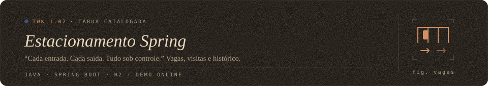
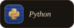
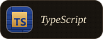
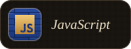
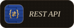
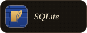
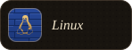
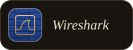
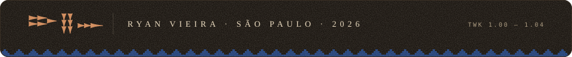

# Ryan Vieira

**Estudante de Desenvolvimento de Sistemas na ETEC Sebrae · Estagiário em Cyber na Deloitte**

Sou de São Paulo e estou no 2º ano do Ensino Médio Técnico em Desenvolvimento de Sistemas na ETEC Sebrae (Centro Paula Souza). Desde agosto de 2026, faço estágio em Cyber (Technology & Transformation) na Deloitte.

Gosto de construir sistemas que resolvem problemas reais, principalmente com Java e Spring Boot. Também estudo cibersegurança e inteligência artificial, com interesse especial em LLMs e agentes.

O visual deste perfil vem do Antigo Oriente Próximo, um período que estudo por interesse próprio. O nome no topo está escrito no alfabeto cuneiforme de Ugarit, uma das escritas alfabéticas mais antigas que conhecemos.

## Me pergunte sobre

- Desenvolvimento de software
- Java e PHP
- Desenvolvimento web
- Cibersegurança
- Inteligência artificial e machine learning

## Projetos

### 01 / Almox TI

Sistema de almoxarifado de TI e manutenção para controlar o empréstimo e o consumo de cabos, periféricos, ferramentas e insumos por técnico ou setor. Começou como uma atividade de Programação Web (cadastro e lista de produtos) e virou um sistema completo.

- **Recursos:** painel com indicadores, retirada por consumo ou por empréstimo com prazo, reposição com custo e auditoria que recalcula o saldo a partir das movimentações.
- **Relatórios:** retiradas e custos de reposição, com exportação em PDF e CSV.
- **Stack:** Java 21+, Spring Boot e Thymeleaf.

**Estado:** sem demo online; roda localmente pelo arquivo `.jar`.

### 02 / Estacionamento Spring

Aplicação web para operar um estacionamento: acompanha a capacidade e a ocupação, registra entradas e saídas e separa o acesso de administradores e operadores.

- **Recursos:** painel de capacidade e ocupação, histórico de entradas e saídas e consulta por placa e por período.
- **Relatórios:** média de permanência, exportação em CSV e backup SQL.
- **Stack:** Java 25, Spring Boot 4.1, Spring MVC, Thymeleaf, Spring Data JPA/Hibernate, H2 e Spring Security.

**Estado:** demo publicada no Render. O primeiro acesso pode demorar enquanto o servidor inicia.

 

### 03 / Aurora

Site educacional sobre a história dos primeiros computadores, de 1936 a 1950. O conteúdo pode ser explorado por eras ou por temas, com biografias de nomes como Alan Turing e Claude Shannon e o contexto histórico de cada período.

- **Recursos:** quiz, versões em português e inglês, widget de acessibilidade, animações e layout responsivo.
- **Stack:** HTML, CSS, JavaScript, Tailwind CSS v4, DaisyUI e GSAP.

**Estado:** demo publicada na Vercel.

 

### 04 / Vetremant

Portal de notícias sobre moda feito na disciplina de Programação Web da ETEC, em 2025.

- **Recursos:** tela de entrada com nome, seções Destaques e Novidades, página própria para cada matéria, menu lateral com rolagem suave e formulário Fale Conosco.
- **Stack:** HTML, CSS e JavaScript, com layout responsivo.

**Estado:** demo publicada na Vercel.

 

Outros projetos

- [**StartApp**](https://github.com/twkryan/App-Escola---Programa-o-Mobile): app Android em Kotlin para controle de vagas, feito na disciplina de Programação Mobile.

## Tecnologias

### Linguagens

Java é a linguagem dos meus projetos de back-end, como o Almox TI e o Estacionamento Spring. JavaScript aparece nos projetos web, e Python, TypeScript e PHP completam as linguagens que uso nos estudos.

### Web

HTML, CSS e JavaScript são a base do Aurora e do Vetremant. Nos projetos em Spring, as páginas são geradas no servidor com Thymeleaf; React e APIs REST fazem parte do que estudo para separar front-end e back-end.

### Dados

SQLite para bancos locais. No Estacionamento Spring, os dados ficam no H2, acessados com Spring Data JPA.

### Segurança

Linux e Wireshark acompanham meus estudos de redes e cibersegurança, a área do meu estágio.

## Aprendendo agora

- Fundamentos de cibersegurança
- Desenvolvimento back-end
- Gerenciamento de banco de dados
- Estruturas de dados e algoritmos
- Fundamentos de machine learning
- Inteligência artificial

## Contato

Para conversar sobre desenvolvimento de software, cibersegurança ou IA:

  

`ryan.felipesilva09@gmail.com` · `@twkryan`

<a href="assets/hero-static.svg">Cabeçalho sem animação</a>

