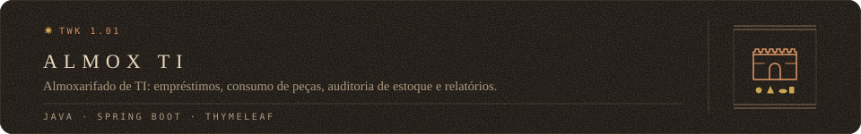
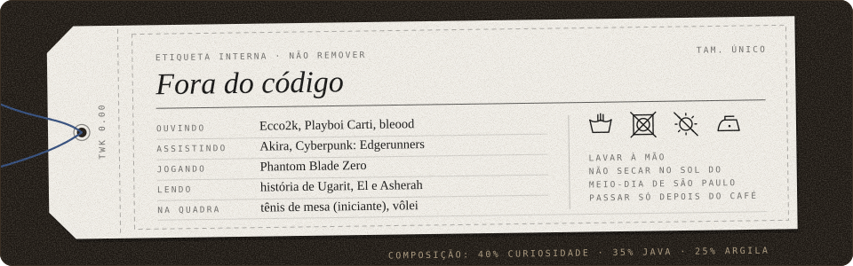

  <picture>
    <source media="(prefers-reduced-motion: reduce)" srcset="assets/hero-static.svg">
    
  </picture>

### oi, eu sou o Ryan

Estudo Desenvolvimento de Sistemas na ETEC e faço estágio em cibersegurança. Gosto de construir sistemas que resolvem problemas reais, principalmente com Java e Spring, e ando cada vez mais curioso sobre IA e agentes.

Fora do código, passo muito tempo lendo sobre o mundo antigo: Ugarit, os deuses do Levante e como as religiões se encontraram e mudaram ao longo do tempo. O nome lá em cima está escrito no alfabeto cuneiforme de Ugarit, uma das escritas alfabéticas mais antigas que conhecemos.

- **construindo agora:** o Almox TI, um almoxarifado de TI de verdade que nasceu de um exercício de sala
- **aprendendo:** IA, agentes e como fazer vários deles trabalharem juntos
- **me pergunte sobre:** Spring Boot, agentes de IA ou por que El e Asherah aparecem juntos nas inscrições antigas
- **fora do código:** tênis de mesa (ainda iniciante), vôlei e muita música

### tábuas catalogadas

Controle de empréstimo e consumo de cabos, periféricos e ferramentas por técnico ou setor, com auditoria de estoque, histórico de retiradas e custos de reposição exportáveis em PDF e CSV. **[código](https://github.com/twkryan/spring-boot-almoxarifado)**

Controle de vagas, entradas, saídas e histórico numa aplicação web simples de operar. **[demo](https://estacionamento-spring-bn9p.onrender.com)** · **[código](https://github.com/twkryan/Estacionamento-Spring)** (o primeiro acesso à demo pode demorar enquanto o servidor acorda)

Uma viagem interativa pela história da computação, das ideias de Alan Turing até a expansão dos anos 1950. **[demo](https://aurora-sdld.vercel.app/)** · **[código](https://github.com/twkryan/Aurora)**

outras tábuas

 

- **[StartApp](https://github.com/twkryan/App-Escola---Programa-o-Mobile)**: app Android em Kotlin para controle de vagas de estacionamento, feito em Programação Mobile
- **[Minerva](https://github.com/twkryan/Minerva)**: plataforma de estudos para vestibulares, em andamento

### ferramentas

### fora do código

